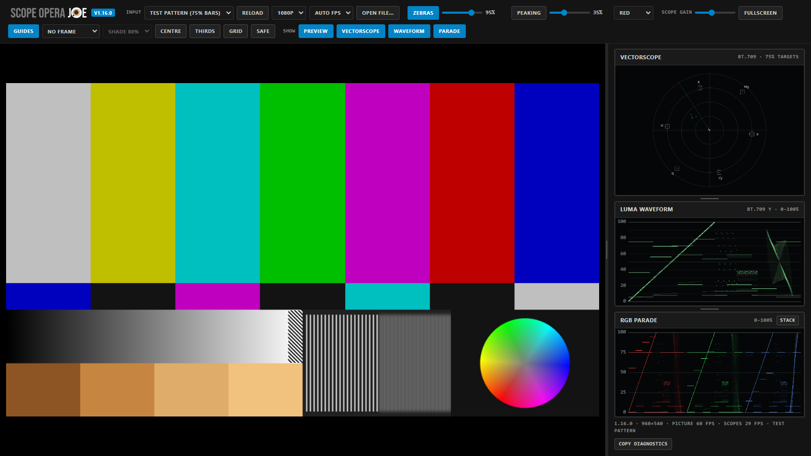

# Scope Opera Joe
Designed by Joseph Stracuzzi

**Live video scopes for your capture card or camera.** Plug in a capture card, pick it from the list, and watch your picture with a vectorscope, RGB parade and luma waveform beside it, plus zebras, focus peaking and frame guides right on the picture.



---

## ⬇️ Download
Get the latest version from the **[Releases page](https://github.com/josephstracuzzi/scope-opera-joe/releases/latest)**. Scope Opera Joe is a portable app: nothing to install, just download and run.

| System | Download | How to run |
|---|---|---|
| Windows 10 / 11 (64-bit) | `Scope Opera Joe <version> Portable.exe` | Double-click it. |
| Linux (x64) | `scope-opera-joe-<version>.tar.gz` | Unpack it, then start `./scope-opera-joe` from that folder. |
| macOS 10.15 or later (experimental) | `Scope Opera Joe <version> Mac Apple Silicon.zip` (M1 and newer) or `Scope Opera Joe <version> Mac Intel.zip` | Unzip it and move **Scope Opera Joe** to Applications. |

The apps are not code-signed, so on first launch Windows SmartScreen says "Windows protected your PC". Click **More info → Run anyway**.

On a Mac, the first time you open it macOS says it can't check the app. Go to **System Settings → Privacy & Security** and click **Open Anyway**. If macOS says the app "is damaged", run `xattr -cr "/Applications/Scope Opera Joe.app"` in Terminal once. macOS also asks once for permission to use the camera. The Mac version is new and hasn't been tested with a capture card yet.

On some Linux systems, Ubuntu 24.04 for example, the app stops at launch with a message about `chrome-sandbox`. Fix it once from the app's folder with `sudo chown root:root chrome-sandbox && sudo chmod 4755 chrome-sandbox`, or start it with `./scope-opera-joe --no-sandbox` instead.

Your settings (layout, guides, last device) are kept in your app-data folder (`%APPDATA%\scope-opera-joe` on Windows, `~/.config/scope-opera-joe` on Linux), so they stay put when you move or replace the app file.

---

## ✨ Features

### Input
- Any **capture card or webcam** your computer sees, including virtual cameras such as OBS, vMix and NDI Webcam. The last one you used opens again at the next launch.
- **RELOAD** lists the devices again (after you plug one in, for example) and reopens the selected one.
- If the selected device sends nothing, the picture says **NO SIGNAL**.
- Ask for **1080p, 2160p or 720p** and a frame rate (**AUTO, 60, 59.94, 50, 30, 29.97, 25, 24**). Capture cards can be picky, so if the card refuses, Scope Opera Joe tries looser settings until it gets a picture.
- A built-in **test pattern**: 75% colour bars, a greyscale ramp, skin-tone patches, sharp and soft lines for peaking, and a rotating hue wheel.
- **OPEN FILE…** to check a video file instead.

### Scopes
- **Vectorscope** (BT.709) with 75% targets for R, Mg, B, Cy, G and Yl, and a skin-tone line.
- **Luma waveform** (BT.709 Y) with a 10% grid.
- **RGB parade** with 0/25/50/75/100% lines. **STACK** overlays red, green and blue in one panel, so where all three match the trace reads white.
- **SCOPE GAIN** makes faint traces brighter.

### On the picture
- **ZEBRAS** stripe everything above a level you choose (50–109%).
- **PEAKING** outlines sharp edges in red, green, blue, yellow or white, with a sensitivity slider.
- **GUIDES**: frame shapes for other deliveries (9:16, 4:5, 1:1, 4:3, 16:9, 1.85, 2:1, 2.39) with the outside shaded, plus **CENTRE**, **THIRDS**, a 4×4 **GRID** and **SAFE** areas (93% action, 90% title). With a frame shape set, the other guides sit inside it.
- Zebras and peaking are drawn on the graphics card in the same pass as the picture, so they never lag behind it.

### Layout
- **SHOW** turns the preview and each scope on or off. Hidden windows stop working, which saves processing.
- Drag the bars between the picture and the scopes to resize them. Double-click a bar to reset it.
- **FULLSCREEN** fills the screen with the picture.
- Your layout and guide settings are remembered.
- Only one copy of the app runs at a time, so a double-click can't open a second one fighting over the capture card.

### Keyboard shortcuts
| Key | Action |
|---|---|
| **G** | Guides on / off |
| **← / →** on the side bar, **↑ / ↓** on the scope bar | Resize |
| **Home** on a bar | Reset its size |

### When something goes wrong
If a device won't open, a message under the scopes says why (for example, another app such as OBS has it). **COPY ERROR DETAILS** and **COPY DIAGNOSTICS** copy a report with your devices, their settings and what was tried, ready to paste into a bug report.

A web page or app can't choose the capture format (YUV or MJPEG); the camera system picks it. Resolution and frame rate are the only levers: high frame rates and 4K often make USB cards switch to MJPEG.

---

## 🛠️ Building from source (developers)
You only need this if you want to change the code. Install [Node.js](https://nodejs.org/), then in the project folder:

```bash
npm install
npm start
```

To make the portable apps yourself, run `npm run build:win` on Windows, `npm run build:linux` on Linux, or `npm run build:mac` on a Mac. The files go to the `dist/` folder.

`npm run logos` renders `logo.png`, `icon.png` and `logo.ico` from the SVG artwork, and `npm run screenshot` makes `docs/screenshot.png`.
